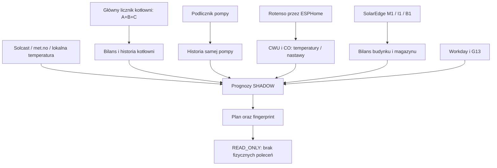

# Mapa zależności EMS2

Podlicznik pompy jest częścią kotłowni: brak strzałki dodającej go do B.
Budynkowy licznik M1 obejmuje kotłownię: również nie dodawać jej drugi raz do H.
Bez potwierdzenia synchronizacji AC−M1 to oszacowanie diagnostyczne.

Zależności encja→encje znajdują się przy każdym rekordzie JSON; te nieodczytane
mają jawnie pustą listę i notę „not resolved”, nie oznacza to samodzielności.
Koszt dzienny ma zależności potwierdzone zgodnością liczb, ale nie formułą helpera.
Schemat nie przedstawia gotowej ścieżki sterowania ACTIVE.
